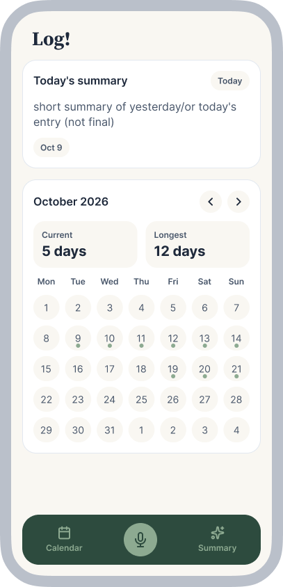
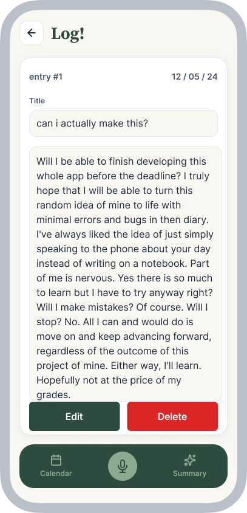
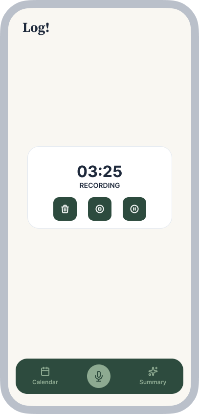

# Mockup and wireframes

The visual plan for this app. Your wireframes answered what goes where; the mockup shows what it looks like.

## Mockup & Screenshots

| Home Calendar | Reading Entry | Recording Entry |
| --- | --- | --- |
|  |  |  |

## Wireframes & Screen Flow

```
home → add entry → entry page ⇄ delete entry option
  ↓
calendar (with indicated entries) → read / edit entry → summarize entry option → home
```

## Screens

1. **Home / Calendar:** Displays the interactive calendar grid with entry markers, streak counter, and bottom action bar.
2. **Recording / Entry Screen:** Allows audio recording, speech-to-text transcription, or fallback typing.
3. **Entry Detail / Summary View:** Displays entry text, playback controls, and AI-generated summary with edit/delete actions.

